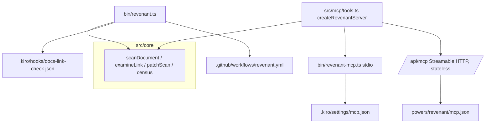

# Design Document: Agent Surfaces

## Overview

One engine, many doors. Agents reach Revenant through MCP tools (over stdio for local development and over stateless Streamable HTTP for the Kiro Power and remote agents); people and automation reach it through the CLI, an agent hook and a GitHub Action. Every door calls the same `src/core` functions, so a verdict is the same wherever it is asked for.

## Architecture



## Components and Interfaces

- **MCP tools** (`src/mcp/tools.ts`, `createRevenantServer()`): `examine_link`, `scan_document`, `scan_source`, `raise_patch` and `census_category`, all with zod inputs and `readOnlyHint` / `openWorldHint` annotations.
- **stdio server** (`bin/revenant-mcp.ts`): used by this repo's `.kiro/settings/mcp.json`.
- **HTTP server** (`src/app/api/mcp/route.ts`): a fresh server and `WebStandardStreamableHTTPServerTransport` per request, with a per-IP hourly limit.
- **CLI** (`bin/revenant.ts`): `scan`, `check`, `hook` and `census`.
- **Agent hook** (`.kiro/hooks/docs-link-check.json`): runs `revenant hook` when the agent saves Markdown.
- **Kiro Power** (`powers/revenant/`): `plugin.json`, `mcp.json` pointing at the hosted endpoint, skills `link-hygiene` and `wikipedia-citations`.
- **GitHub Actions**: `ci.yml` (typecheck, lint, tests) and `revenant.yml` (scan changed Markdown, fail on possessed).

## Data Models

```ts
// scan_document / scan_source result
interface ScanReport {
  document: string; format: DocumentFormat;
  linksChecked: number; linksNotChecked: number;
  counts: Record<Verdict, number>;
  problems: { url: string; verdict: Verdict; confidence: number; summary: string;
              evidence: string[]; remedy: Remedy; cited: string; offset: number }[];
}
// raise_patch adds: applied, skipped, diff, patched (the full text; nothing is written)
```

CLI exit codes: 0 clean, 1 a `--fail-on` verdict was found, 2 usage or input error, 3 a census stopped before the end.

## Decisions

- **Stateless HTTP**: a fresh `McpServer` and `WebStandardStreamableHTTPServerTransport` per request with `enableJsonResponse`, so the route works on serverless without sticky sessions.
- **Hook never blocks**: `PostFileSave` hooks fire after agent writes; a broken link is information for the agent, not a reason to stop it. The hook prints `Revenant: <file>: <verdict> link <url>: … Archived copy: …`.
- **Hook payload parsing** is defensive: it walks the JSON and collects any string under a key containing `path` or `file` that ends in `.md`, `.mdx`, `.wiki` or `.html`, because the payload shape differs between Kiro surfaces.
- **Power points at the hosted endpoint** so installing it needs no Node toolchain; the repo's own `.kiro/settings/mcp.json` uses stdio for local development.

## Correctness Properties

The surfaces are thin wrappers over the engine, whose properties are in the other specs. They are checked with example-based tests rather than generated ones:

- Payload parsing finds every document path in nested objects and arrays and ignores everything else (`tests/unit/cli-hook.test.ts`).
- The MCP tool list is stable: exactly the five tools, each read-only and open-world (`tests/unit/mcp-tools.test.ts`).
- The guard hook blocks a spoofed browser user agent, bypass tooling and staging `private/` or `.env` (`tests/unit/guard-hook.test.ts`).

## Error Handling

- An invalid URL or an unknown source becomes an MCP result with `isError: true` and a plain message, never a crash.
- `/api/mcp` answers 429 with `Retry-After` past its hourly limit.
- `revenant hook` exits 0 even when it finds problems, and ignores payloads it cannot parse.
- `census_category` stops after about four minutes and reports what it finished.

## Testing Strategy

Unit tests cover the tool list, input rejection, the census cap, payload parsing and the guard. The hosted endpoint was checked after deployment by listing its tools and calling `examine_link` with the MCP SDK client.
