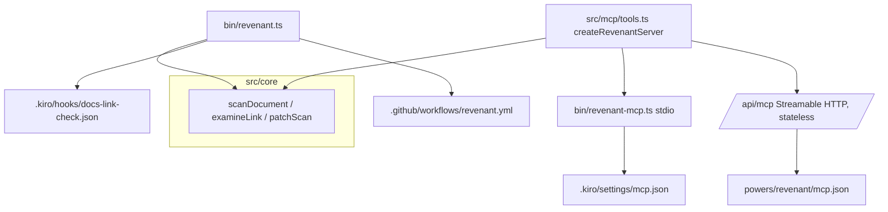

# Design Document: Agent Surfaces

## Overview

## Decisions

- **Stateless HTTP**: a fresh `McpServer` and `WebStandardStreamableHTTPServerTransport` per request with `enableJsonResponse`, so the route works on serverless without sticky sessions.
- **Hook never blocks**: `PostFileSave` hooks fire after agent writes; a broken link is information for the agent, not a reason to stop it. The hook prints `Revenant: <file>: <verdict> link <url>: … Archived copy: …`.
- **Hook payload parsing** is defensive: it walks the JSON and collects any string under a key containing `path` or `file` that ends in `.md`, `.mdx`, `.wiki` or `.html`, because the payload shape differs between Kiro surfaces.
- **Power points at the hosted endpoint** so installing it needs no Node toolchain; the repo's own `.kiro/settings/mcp.json` uses stdio for local development.

## Correctness Properties

- Payload parsing finds every Markdown path in nested objects and arrays and ignores non-document paths (unit test `tests/unit/cli-hook.test.ts`).
- The MCP tool list is stable: exactly the four tools with their annotations (unit test `tests/unit/mcp-tools.test.ts`).
