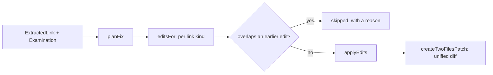

# Design Document: Citation Patcher

## Overview

Patching is a list of non-overlapping `TextEdit {start, end, replacement}` against the original text, applied in one pass (`applyEdits`). Edits are computed from the extractor's spans, so the patcher never re-parses free text. The whole module is pure, so the web app builds the patch in the browser and the user's document never goes back to the server.

## Architecture



## Components and Interfaces

- `setTemplateParams(text, span, updates)` (`src/core/patch/wikitext.ts`) re-parses one template, detects its style (`detectStyle`: tight, spaced, airy or multi-line, plus `name = value` spacing) and emits edits. Legacy `dead-url` is rewritten in place to `url-status`.
- `formatDateLike(iso, example)` mirrors `6 March 2014`, `March 6, 2014`, `6 Mar 2014` or ISO.
- `planFix(link, exam, takeoverDate)` (`src/core/patch/index.ts`) decides what to write and keeps a clean existing archive copy.
- `citeUpdates(text, fix)` returns the CS1 parameters a fix writes; the census worklist shows the same values.
- `applyFixes(text, fixes, format, fileName)` builds edits per link kind, rejects overlaps and renders the diff with jsdiff.
- `RaisePanel` (`src/components/scan/raise-panel.tsx`) copies the patched source, downloads a `.patch` or the file, and opens the Wikipedia or GitHub editor with an edit summary.

## Data Models

```ts
interface TextEdit { start: number; end: number; replacement: string }
interface PlannedFix { link: ExtractedLink; verdict: Verdict; remedy: Remedy }
interface PatchResult {
  text: string;   // the patched document
  diff: string;   // unified diff
  applied: { linkId: string; url: string; verdict: Verdict; change: string }[];
  skipped: { linkId: string; url: string; reason: string }[];
}
```

## Correctness Properties

All in `tests/property/wikitext-patch.test.ts` and `tests/property/extract-and-guard.test.ts`, generated over random cite templates in four spacing styles, with random parameters, access-date formats and existing status.

### Property 1: Text outside the patched template is byte-identical
**Validates: Requirements 1.1**

### Property 2: Every parameter not being set keeps its exact value
**Validates: Requirements 1.1, 1.2**

### Property 3: After patching, the template carries exactly the requested values, once each
**Validates: Requirements 1.2, 1.3, 1.4**

### Property 4: Patching is idempotent
**Validates: Requirements 1.6**

### Property 5: The cited URL and access date survive the patch
**Validates: Requirements 1.1**

### Property 22: Markdown fixes only change URLs and a second pass finds nothing to fix
**Validates: Requirements 2.1, 1.6**

## Error Handling

- A link with no archived copy to point at is skipped with the reason "no archived copy to point at".
- A fix whose edit overlaps an earlier one is skipped ("overlaps another fix"), so two fixes never corrupt each other.
- A fix that would change nothing is skipped as "already up to date".
- Skipped links are listed in the raise panel under "Left for a person".

## Testing Strategy

Property tests generate templates in every spacing style and check the guarantees above; example tests in the same file cover date formats and the legacy `dead-url=yes` rewrite. The raise panel is checked by hand on the PHP article.
