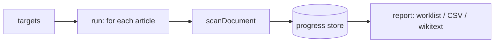

# Design Document: Graveyard Census

## Overview

A census reuses `loadDocument` (Wikipedia) and `scanDocument` from `src/core`. New pieces:

- `src/core/census/targets.ts`: resolve a category, domain or title list into article titles (`list=categorymembers`, `list=exturlusage`, both paginated with `continue`).
- `src/core/census/run.ts`: iterate articles, de-duplicate URLs across the run, persist progress (Upstash Redis when configured, `.revenant/census/<id>.json` in the CLI).
- `src/core/census/report.ts`: pure functions from results to worklist rows, CSV and a wikitext table.
- `bin/revenant.ts census <category|domain:example.com|titles.txt>`.
- `src/app/census/page.tsx`: start a small census (≤ 2,000 articles) and view a stored run.



## Correctness Properties

- **Property C1: A URL appears at most once among the examinations of a run.** _Validates: Requirement 2.1_
- **Property C2: Resuming a run after any prefix of articles yields the same final report as an uninterrupted run (given the same examinations).** _Validates: Requirement 2.2_
- **Property C3: Every row in the main worklist has ≥ 2 evidence items pointing to its verdict; others are in review.** _Validates: Requirement 4.2_
- **Property C4: The CSV round-trips: parsing the CSV gives back the rows (titles and claims may contain commas, quotes and newlines).** _Validates: Requirement 3.2_
- **Property C5: The wikitext table escapes `|` and `}}` in cells so it never breaks the page.** _Validates: Requirement 3.2_

## Data model

```ts
interface CensusRun {
  id: string;
  createdAt: string;
  source: { kind: "category" | "domain" | "titles"; value: string };
  articles: string[];
  done: number;          // articles finished
  seenUrls: string[];    // de-dup
  rows: CensusRow[];
  version: string;
}
interface CensusRow {
  article: string; claim: string; url: string;
  verdict: Verdict; confidence: number; tagged: boolean;
  evidence: string[]; fix?: string; review: boolean;
}
```
