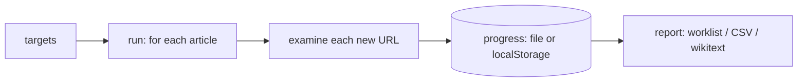

# Design Document: Graveyard Census

## Overview

A census reuses `loadDocument` (Wikipedia) and the examine pipeline from `src/core` to scan many articles, examining each distinct URL once, and turns the results into a worklist of possessed citations nobody has tagged. It runs in the CLI, in the hosted app (driven from the browser) and as an MCP tool.

## Architecture



## Components and Interfaces

- `src/core/census/targets.ts`: `parseCensusSource(raw, lang)` and `resolveTargets(target, limit)` turn a category, domain or title list into article titles (`list=categorymembers`, `list=exturlusage`, both paginated with `continue`).
- `src/core/census/run.ts`: `createRun(source, articles)` and `runCensus(run, deps)`, the loop. It iterates articles, examines each distinct URL once and builds worklist rows. Loading and examining are injected (`CensusDeps`), so it runs in the CLI, in the browser and in tests.
- `src/core/census/report.ts`: `buildReport(run)`, `toCsv(rows)`, `parseCsv(csv)` and `toWikitext(report)`, pure functions from a run to totals, worklist and review lists and exports.
- `src/core/census/store.ts`: `saveRun` / `loadRun` for `.revenant/census/<id>.json` in the CLI. `src/core/census/server.ts` wires the real network.
- `bin/revenant.ts census <category|domain:example.com|titles.txt>` (`src/cli/census.ts`), and `npm run census:publish -- <id>` for the home page.
- `src/app/census/page.tsx` with `POST /api/census/targets` and `POST /api/census/article`: start a census of up to 2,000 articles, watch it, export the worklist.
- MCP tool `census_category` (read-only, at most 50 articles, stops after about four minutes).

## Decisions
- **The browser drives the hosted run.** A serverless function ends with its request, and one article can take longer than a function may run, so `/census` loads one article and examines its links through the existing routes, and keeps the run in localStorage. Resuming, exporting and opening a CLI run file all work from there. Because of this, **Upstash Redis is not used for census progress**; the first draft of this design listed it.
- **A URL is examined once per census.** The first citation of a URL (and its access date) speaks for it. Later citations of the same URL, in the same or another article, get their own row with the same verdict, evidence and archived copy but their own citing sentence and their own `tagged` state. The claim check belongs to the first citation.
- **An article is committed all at once.** Rows, counts and `seenUrls` change only when every new URL of the article has an answer. If a run stops in the middle of an article (pause, rate limit, Ctrl-C), nothing from it is recorded and the next run starts it again. Examinations are cached, so the repeat is cheap.
- **Pause is not failure.** A rate limit, a busy Wikipedia or a lost connection raises `CensusPaused` and keeps the article for later. An article that cannot be loaded for good (missing page) is recorded in `errors` and counted as finished. A link whose examination crashes counts as `unknown`.
- **Independent signals.** Evidence is grouped by the id up to its first hyphen (`parking-host` and `parking-page` are one `parking` cause; `rdap-reregistered` is `rdap`; `spam-terms` and `spam-redirect` are `spam`). A row lists the strongest evidence line of each family that points to its verdict. Two or more lines put it on the worklist; fewer put it in review.
- **Tagged.** A row is `tagged` when its citation already carries the `url-status` Revenant would write: `usurped` or `unfit` for possessed, `dead` for ghost, `deviated` for changeling. Tagged rows are kept and counted in the totals, but are not on the worklist.
- **Needs a new source.** `needsNewSource` is true when there is no archived copy, no claim check was made, or the claim check says the copy does not support the sentence (Requirement 4.1).
- **Buried and unknown links are counted, not listed.** Plain dead links are what existing tools already find.
- **Spreadsheets and wikitext are hostile places.** Claims and URLs come from web pages, so CSV cells that start like a formula get a leading apostrophe (undone on parse), and the wikitext table escapes markup and colons so no address becomes a link.

## Correctness Properties

In `tests/property/census.test.ts`. Properties 24 and 25 run the real engine against generated articles and a stand-in examine step; 26 to 28 test the report on generated rows.

### Property 24: A URL appears at most once among the examinations of a run
**Validates: Requirements 2.1**

### Property 25: Resuming a run after any prefix of articles yields the same final report as an uninterrupted run
Given the same examinations.
**Validates: Requirements 2.2**

### Property 26: Every row in the main worklist has at least two independent signals; the others are in review
**Validates: Requirements 4.2, 3.1**

### Property 27: The CSV round-trips
Parsing the CSV gives back the rows, including commas, quotes, newlines and text that starts like a spreadsheet formula.
**Validates: Requirements 3.2**

### Property 28: The wikitext table escapes markup in every cell, so it never breaks the page
**Validates: Requirements 3.2**

## Data Models

```ts
interface CensusRun {
  id: string;
  createdAt: string;
  finishedAt?: string;
  version: string;            // Revenant version
  source: { kind: "category" | "domain" | "titles"; value: string; lang: string };
  articles: string[];
  moreArticles: boolean;      // the source had more than the limit
  done: number;               // articles finished
  seenUrls: string[];         // de-dup
  citations: number;          // links in finished articles, repeats counted
  notChecked: number;         // links over the per-article limit
  counts: Record<Verdict, number>;          // per distinct URL
  findings: Record<string, Examination>;    // reportable verdicts, so repeats need no request
  rows: CensusRow[];
  errors: { article: string; message: string }[];
}
interface CensusRow {
  article: string; claim: string; url: string;
  verdict: Verdict; confidence: number; tagged: boolean;
  evidence: string[];         // one line per independent signal for the verdict
  fix?: string;               // the CS1 parameters to write, or the replacement
  needsNewSource: boolean;
}
```
`review` is not stored: a row is on the worklist when it is untagged and has at least two evidence lines, and in review otherwise.

## Error Handling

- Wikipedia answering 429 or 5xx, or not answering at all, raises `CensusPaused`: the run stops with its progress saved and the article is redone on resume.
- A missing article goes to `errors` and the run continues.
- An examination that throws counts as `unknown`; one that takes longer than two minutes (`examineTimeoutMs`) also counts as `unknown`, so one stuck request cannot hold the census.
- A citation with no sentence of its own (inside an infobox or `{{Reflist}}`) is shown as `Cited page: "<title>"` instead of template text, and the same sentence citing the same URL twice is one row.
- The hosted app refuses more than 2,000 articles and points to the CLI; a run file opened in the browser is validated with zod before it is trusted.

## Testing Strategy

Property tests 24–28 and unit tests (`tests/unit/census-run.test.ts`, `tests/unit/census-targets.test.ts`) run offline against stand-in articles and a stubbed MediaWiki API. Breaking the de-duplication or the resume on purpose made Properties 24 and 25 fail. Two real censuses (`docs/CENSUS.md`) were run after the tests passed.

