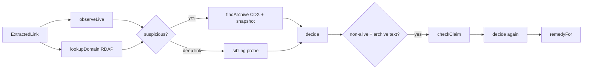

# Design Document: Link Classifier

## Overview

Classification is split into an **impure observation phase** (`examine.ts`: live page, RDAP, Wayback, sibling probe, claim check) and a **pure decision phase** (`signals/verdict.ts`: observations → decision). The split lets property tests explore the decision space without the network, and lets the browser, CLI and MCP server share one engine.

## Architecture



## Components and Interfaces

### Extractors (`src/core/extract/`)
- `wikitext.ts`: a brace/bracket-aware template scanner (`findTemplateEnd`, `parseTemplate`) that records parameter spans; `claimBefore` walks back over adjacent `<ref>`s to the sentence they support.
- `markdown.ts`: code spans are computed first and every match inside them is dropped.
- `html.ts`: outbound anchors only (different registrable domain).

### Signals (`src/core/signals/`)
- `lexicon.ts` is data: parking hosts and phrases, multilingual spam terms, soft-404 phrases, gambling host pattern.
- `verdict.ts` combines evidence per verdict with noisy-OR; problems win ties, `alive` must win by 0.15; problems below 0.5 fall back to `alive` (if the page answered) or `unknown`.

### Decision rules

| Signal | Points to | Weight |
|---|---|---|
| DNS gone | buried | 0.92 |
| 404 / 410 | buried | 0.96 |
| 401/402/403/405/406/429/451/999 | unknown | 0.6 |
| parking host / 2+ parking phrases | possessed | 0.93 / 0.9 |
| spam jump ≥ 0.34 with live spam ≥ 0.5 | possessed | 0.6 + 0.35·jump |
| RDAP re-registered after access date | possessed | 0.8 if similarity < 0.12, 0.55 unknown, 0.2 if similar |
| redirect to gambling-named domain | possessed | 0.88 |
| error-page title | ghost | 0.88 |
| deep link → home page | ghost | 0.75 |
| sibling probe ≥ 90% identical | ghost | 0.8 |
| archive matched title, live does not | changeling | 0.6 |
| claim check: archive supports, live does not | changeling | 0.85 |

## Data Models

```ts
interface ExtractedLink { id: string; rawUrl: string; url: string; kind: LinkKind; span: Span; urlSpan: Span;
  title?: string; context: string; accessDate?: string; existingArchive?: { url: string; date?: string }; existingStatus?: string; quote?: string }
interface LiveObservation { ok: boolean; status?: number; finalUrl?: string; redirects: string[]; title?: string; text?: string; errorKind?: string; fetchedAt: string }
interface Evidence { signal: string; detail: string; points: Verdict; weight: number }
interface Examination { linkId: string; url: string; verdict: Verdict; confidence: number; summary: string; evidence: Evidence[];
  live?: LiveObservation; domain?: DomainObservation; archive?: ArchiveObservation; claim?: ClaimCheck; remedy: Remedy }
```

The full definitions are in `src/core/types.ts`.

## Correctness Properties

Each property is a fast-check test in `tests/property/verdict.test.ts` or `tests/property/extract-and-guard.test.ts`.

### Property 10: A 404 or 410 is always buried
**Validates: Requirements 2.1**

### Property 11: A domain that no longer resolves is always buried
**Validates: Requirements 2.1**

### Property 12: A page that answered is never buried, and a page that failed is never alive
**Validates: Requirements 2.1, 2.8**

### Property 13: Turning a page into a parked domain never leaves it alive
**Validates: Requirements 2.2**

### Property 14: A gambling takeover the archive never had is possessed
**Validates: Requirements 2.3**

### Property 15: Confidence is within [0, 1] and every verdict has a summary
**Validates: Requirements 2.9**

### Property 17: URL normalisation is idempotent
**Validates: Requirements 1.5**

### Property 19: Every Markdown link's span slices to its raw URL
**Validates: Requirements 1.5**

### Property 20: URLs inside code blocks are never extracted
**Validates: Requirements 1.4**

### Property 21: Every wikitext link's span slices to its raw URL
**Validates: Requirements 1.1, 1.5**

## Error Handling

Network failures never throw out of `examine`: they become `LiveObservation.errorKind` (`dns`, `timeout`, `refused`, `tls`, `blocked`, `other`) and therefore evidence. A failing claim check falls back to the lexical check.

## Testing Strategy

Property tests for invariants; regression tests (`tests/unit/takeover-patterns.test.ts`) quote real pages the benchmark misjudged; the benchmark (`scripts/benchmark.ts`) measures recall on editor-labelled `usurped` citations and the false-possessed rate on `live` ones.
