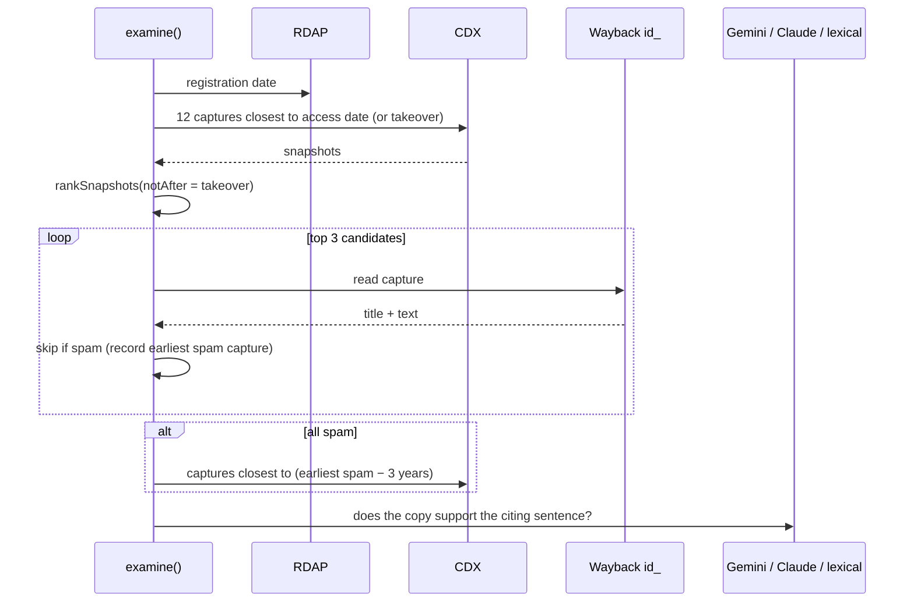

# Design Document: Resurrection Engine

## Overview

`net/sources.ts` talks to two public services: **RDAP** (`rdap.org/domain/<d>`, registration events) and the **Wayback CDX API** (`/cdx/search/cdx?closest=<ts>&sort=closest&filter=statuscode:200`). Snapshot choice is a pure function (`archive/select.ts`); reading a snapshot uses the raw `id_` form so no toolbar markup leaks into the text.

## Claim check

- Provider (`claim/llm.ts`, `claimProvider`): Gemini when `GEMINI_API_KEY` is set (default model `gemini-3.8-flash`, `responseJsonSchema`, thinking level low), otherwise Claude when `ANTHROPIC_API_KEY` is set (`claude-opus-5-5`, `client.beta.messages.parse` with a zod schema, effort low, `fallbacks: "default"`), otherwise lexical. `REVENANT_LLM` forces a provider or `off`; `REVENANT_MODEL` overrides the model.
- Both providers share `claim/prompt.ts`: one system prompt, one schema `{archive, live, quote, rationale}`, one user message layout and one post-check (`toClaimCheck`).
- Prompt puts page text inside `<archived_page>`/`<live_page>` tags and says it is untrusted data. The quote is kept only if its first 40 characters really occur in the archived text.
- Fallback: `claim/lexical.ts` (coverage of the claim's tokens; quote match ≥ 85% counts as supported).

## Correctness Properties

In `tests/property/snapshot-selection.test.ts`, `tests/property/extract-and-guard.test.ts`, `tests/property/verdict.test.ts`:

- **Property 6: Never selects a copy captured on or after the takeover date.** _Validates: Requirement 1.4_
- **Property 7: Only selects 200 responses with a readable type.** _Validates: Requirement 1.3_
- **Property 8: The selected copy is the closest eligible one to the target.** _Validates: Requirement 1.1_
- **Property 9: If any eligible copy predates the takeover, one is selected.** _Validates: Requirements 1.4, 3.3_
- **Property 16: Possessed links are hidden (usurped/unfit), changelings are deviated.** _Validates: Requirements 3.1, 3.2_
- **Property 23: Every RFC 1918, loopback and link-local IPv4 address is refused.** _Validates: Requirement 4.1_

## Caching

| Key | TTL | Notes |
|---|---|---|
| `live:<url>` | 6 h (20 min if transient) | timeouts retried once at 25 s |
| `rdap:<domain>` | 7 days | 404 cached, other failures not |
| `cdx:<url>:<day>` | 3 days | failures throw, never cached |
| `snap:<ts>:<url>` | 30 days | |
| `exam:v2:<url>:<access>:<ctx>` | 12 h (10 min if unknown) | |
