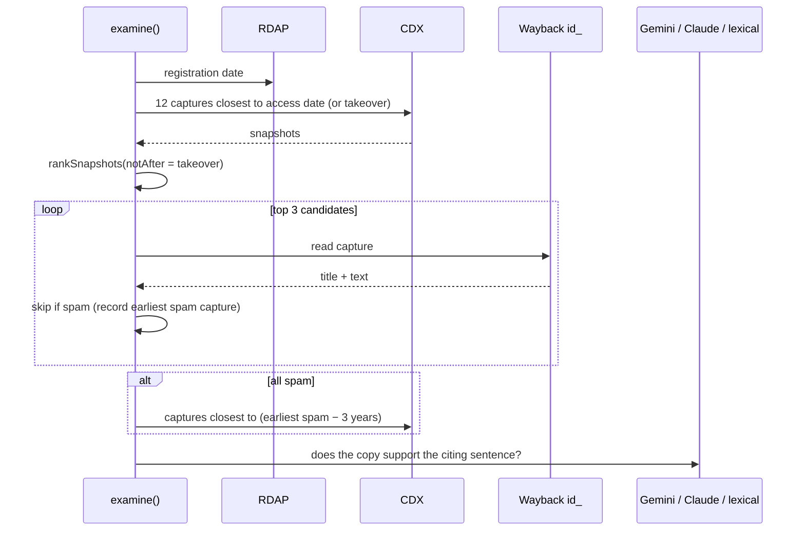

# Design Document: Resurrection Engine

## Overview

`net/sources.ts` talks to two public services: **RDAP** (`rdap.org/domain/<d>`, registration events) and the **Wayback CDX API** (`/cdx/search/cdx?closest=<ts>&sort=closest&filter=statuscode:200`). Snapshot choice is a pure function (`archive/select.ts`); reading a snapshot uses the raw `id_` form so no toolbar markup leaks into the text. The chosen copy is then checked against the citing sentence, and the decision becomes a remedy in Wikipedia's CS1 vocabulary.

## Architecture



## Components and Interfaces

- `lookupDomain(domain)` (`net/sources.ts`): current registration date from RDAP.
- `listSnapshots(url, target)`, `firstSeen(url)`, `readSnapshot(s)`, `findArchive(url, opts)` (`net/sources.ts`): CDX queries with a circuit breaker, snapshot text, and the full selection loop above.
- `parseCdx`, `rankSnapshots`, `selectSnapshot` (`archive/select.ts`): pure ranking by distance to the target, never on or after `notAfter`.
- `checkClaim(input)` (`claim/llm.ts`): picks Gemini, Claude or the lexical check; `claim/prompt.ts` holds the shared prompt, schema and quote check.
- `remedyFor(decision, archive)` (`signals/verdict.ts`): maps a verdict to a `Remedy`.
- `safeFetch`, `assertPublicUrl`, `withHostLimit` (`net/fetch.ts`, `net/guard.ts`, `net/limiter.ts`): bounded, SSRF-checked, per-host-limited requests.

## Data Models

```ts
interface Snapshot { timestamp: string; original: string; status: number; mimetype?: string; digest?: string }
interface ArchiveObservation { snapshot?: Snapshot; url?: string; title?: string; text?: string; candidates: number; firstSeen?: string }
interface ClaimCheck { archive: ClaimSupport; live?: ClaimSupport; quote?: string; rationale: string; method: "llm" | "lexical"; model?: string }
interface Remedy { action: "none" | "archive" | "manual"; urlStatus?: UrlStatus; archiveUrl?: string; archiveDate?: string; note?: string }
```

## Claim check

- Provider (`claim/llm.ts`, `claimProvider`): Gemini when `GEMINI_API_KEY` is set (default model `gemini-3.8-flash`, `responseJsonSchema`, thinking level low), otherwise Claude when `ANTHROPIC_API_KEY` is set (`claude-opus-5-5`, `client.beta.messages.parse` with a zod schema, effort low, `fallbacks: "default"`), otherwise lexical. `REVENANT_LLM` forces a provider or `off`; `REVENANT_MODEL` overrides the model.
- Both providers share `claim/prompt.ts`: one system prompt, one schema `{archive, live, quote, rationale}`, one user message layout and one post-check (`toClaimCheck`).
- Prompt puts page text inside `<archived_page>`/`<live_page>` tags and says it is untrusted data. The quote is kept only if its first 40 characters really occur in the archived text.
- Fallback: `claim/lexical.ts` (coverage of the claim's tokens; quote match ≥ 85% counts as supported).

## Correctness Properties

In `tests/property/snapshot-selection.test.ts`, `tests/property/extract-and-guard.test.ts` and `tests/property/verdict.test.ts`.

### Property 6: Never selects a copy captured on or after the takeover date
**Validates: Requirements 1.4**

### Property 7: Only selects 200 responses with a readable type
**Validates: Requirements 1.3**

### Property 8: The selected copy is the closest eligible one to the target
**Validates: Requirements 1.1**

### Property 9: If any eligible copy predates the takeover, one is selected
**Validates: Requirements 1.4, 3.3**

### Property 16: Possessed links are hidden (usurped/unfit), changelings are deviated
**Validates: Requirements 3.1, 3.2**

### Property 23: Every RFC 1918, loopback and link-local IPv4 address is refused
**Validates: Requirements 4.1**

## Caching

| Key | TTL | Notes |
|---|---|---|
| `live:<url>` | 6 h (20 min if transient) | timeouts retried once at 25 s |
| `rdap:<domain>` | 7 days | 404 cached, other failures not |
| `cdx:<url>:<day>` | 3 days | failures throw, never cached |
| `snap:<ts>:<url>` | 30 days | |
| `exam:v2:<url>:<access>:<ctx>` | 12 h (10 min if unknown) | |

## Error Handling

- Upstream failures (429, 5xx, timeouts) throw inside `cached(...)`, so nothing is stored; the caller returns an empty result for this request only.
- After three CDX failures in a row the archive is left alone for a minute (`cdxPaused`), and remedies say the archive is not answering instead of "no copy exists".
- Every body read has its own deadline, so a server that answers 200 and then goes quiet becomes a timeout.
- Any LLM error falls back to the lexical check; a quote that is not verbatim in the archived text is dropped.

## Testing Strategy

Property tests cover snapshot selection, the remedy vocabulary and the SSRF guard. Unit tests cover provider selection (`tests/unit/claim-provider.test.ts`) and the stalled-body deadline (`tests/unit/fetch-deadline.test.ts`). The benchmark measures the whole pipeline against editors' own tags.
