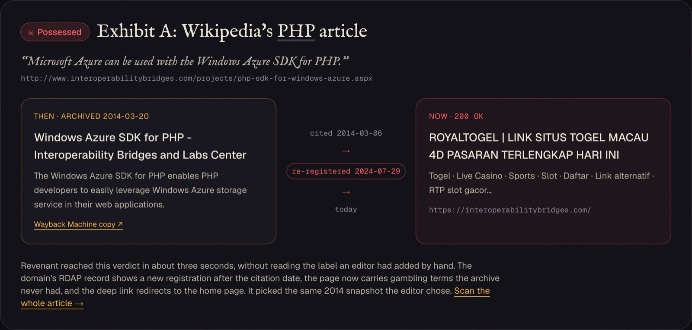
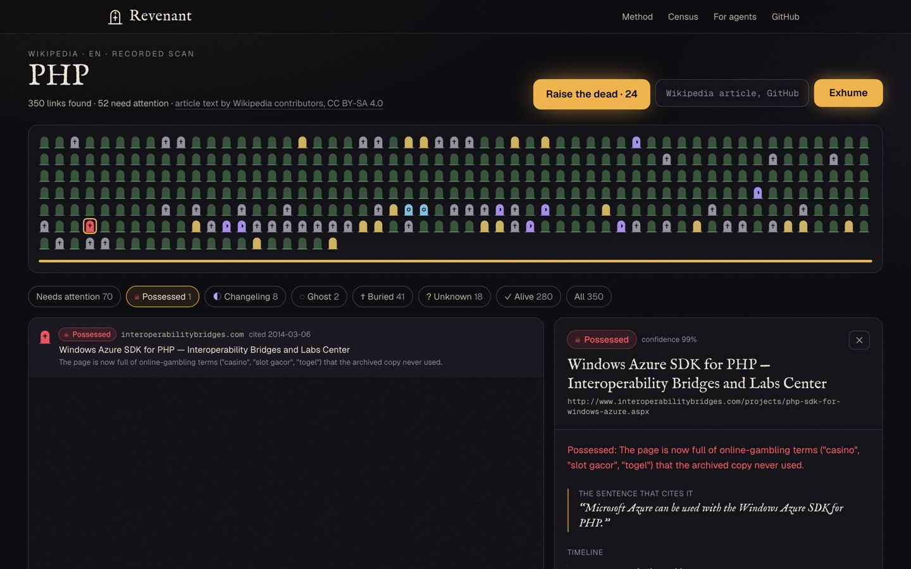

# Revenant

**Some links come back wrong.**

A cited domain expires. A squatter buys it. The link still answers `200 OK`, so every dead-link checker calls it alive, and readers land on a casino. Revenant finds those links, along with soft 404s and rewritten pages. It raises the original from the Internet Archive, checks it against the sentence that cites it, and hands you a ready fix.



- **Live app:** https://revenant-links.vercel.app (try `wiki:PHP`)
- **Demo video:** _link added at submission_
- **Kiroween 2026 category:** Resurrection: the dead web, raised.

## Why

| Measured 2026-11-02 | |
|---|---|
| English Wikipedia articles where editors already flagged a citation as **usurped**, by hand | **155,603** |
| Articles with at least one citation marked **dead** | **1,935,336** |

Link checkers ask one question: does the URL answer 200? Wikipedia's PHP article cites a Microsoft page about the Windows Azure SDK. Since July 2024 that domain has belonged to someone else, and the link redirects to an Indonesian lottery site that answers `200 OK`. Revenant reaches that verdict in about three seconds without being told, and picks the same 2014 snapshot the human editor chose.

## What it does

1. **Exhume.** Give it a Wikipedia article, a GitHub README or file, any web page, or pasted wikitext, Markdown or HTML. Every link is extracted with the sentence it supports and its access date.
2. **Examine.** Each link gets one of six verdicts, mapped onto Wikipedia's own `url-status` values:

   | Verdict | What happened | `url-status` |
   |---|---|---|
   | ☠ possessed | the domain changed hands: parked, for sale, gambling or spam | `usurped` / `unfit` |
   | ◐ changeling | same site, but the cited content was replaced | `deviated` |
   | ◌ ghost | soft 404: 200 OK with an error page, or a redirect to the home page | `dead` |
   | ✝ buried | 404, 410, DNS gone | `dead` |
   | ? unknown | bot wall or timeout: a person should look | |
   | ✓ alive | still there, still what was cited | `live` |

   Evidence comes from the live page, **RDAP** registration dates (a domain registered after the citation date has a new owner), the **Wayback Machine** capture nearest the access date, multilingual spam and parking signatures, and a soft-404 sibling probe.
3. **Raise the dead.** Revenant picks the archived copy closest to when the author read the page, **never one captured after the takeover** (the archive keeps crawling squatters). It checks with Gemini (or Claude), or by word overlap without a key, that the copy supports the citing sentence. Then it writes the fix: `archive-url`, `archive-date` in the citation's own date style, and `url-status`. Every other byte is untouched. You copy the patch, download a `.patch`, or open the Wikipedia or GitHub editor. Revenant never edits anything for you.



## Measured, not claimed

Wikipedia editors' own tags are ground truth. On a held-out sample (seed 4040, never used for tuning), Revenant, without seeing the tags:

- flagged **60 of 67** judgeable citations tagged `usurped` (90%), and
- called **0 of 80** citations tagged `live` possessed.

Method, per-row results and the misses we found and fixed along the way: [docs/BENCHMARK.md](docs/BENCHMARK.md).

## Use it from your agent

- **MCP server** with `examine_link`, `scan_document`, `scan_source` and `raise_patch`, over stdio (`npm run mcp`) or Streamable HTTP (`/api/mcp`).
- **Kiro Power** in [`powers/revenant`](powers/revenant): import from GitHub in Kiro's Powers panel.
- **Agent hook**: Revenant checks the Markdown your agent just saved ([`.kiro/hooks/docs-link-check.json`](.kiro/hooks/docs-link-check.json)).
- **CLI**: `npx tsx bin/revenant.ts scan README.md --fail-on possessed` exits 1 when it finds one; `--fix` rewrites local files.
- **GitHub Action**: [`.github/workflows/revenant.yml`](.github/workflows/revenant.yml) fails a pull request that adds a possessed link.

Details on the [/agents](https://revenant-links.vercel.app/agents) page.

## Built with Kiro

The [`/.kiro`](.kiro) directory holds what Kiro reads: seven steering files (always, fileMatch and auto inclusion), six specs in EARS with correctness properties (including a bugfix spec for the benchmark misses and an open spec for the next feature), seven hooks (tests on save, a typecheck on UI saves, Revenant checking its own docs, a PreToolUse guard against bot-check circumvention, and more), two custom agents, MCP servers and a Power. Walkthrough: [docs/KIRO.md](docs/KIRO.md).

## Run it

```bash
npm install
npm run dev        # http://localhost:3000
npm test           # 46 tests, including 23 fast-check properties
```

Everything works without keys. Optional: `GEMINI_API_KEY` (or `ANTHROPIC_API_KEY`) for model claim checks, Upstash Redis for a shared cache. See [docs/DEPLOYMENT.md](docs/DEPLOYMENT.md) and [docs/ARCHITECTURE.md](docs/ARCHITECTURE.md).

## Good citizenship

Revenant identifies itself as `RevenantBot` with a link to this repository, keeps two requests per host (three for the Wayback Machine), never caches a failure as an answer, and never tries to get past a bot check. Those sites are reported as `unknown`. It reads public data only: the Wayback CDX API, RDAP, the MediaWiki API and the pages you ask about.

## License

MIT. Wikipedia text shown in the app and stored in `public/featured/` is by Wikipedia contributors under CC BY-SA 4.0.
