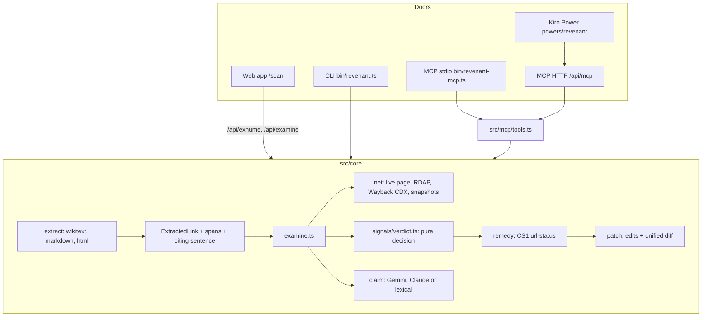

# Architecture

Revenant is one engine (`src/core`) with five front doors: the web app, the CLI, an MCP server over stdio, the same MCP server over HTTP, and the Kiro Power that points at it.

## Request flow in the web app

1. `POST /api/exhume` loads the source (Wikipedia API, GitHub API/raw, web page or pasted text) and returns the document with every extracted link. Nothing is examined yet.
2. The browser groups links by URL + access date and calls `POST /api/examine` six at a time. Each call is short (one link), so serverless limits are never hit and verdicts stream into the graveyard map.
3. The patch is built in the browser (`src/core/patch` is pure), so the user's document never needs to go back to the server.

## Pure vs. impure

| Pure (browser-safe, property-tested) | Impure (server only) |
|---|---|
| `extract/*`, `signals/*`, `archive/select.ts`, `patch/*`, `claim/lexical.ts`, `text.ts`, `url.ts`, `dates.ts`, `group.ts` | `net/*`, `claim/llm.ts`, `examine.ts` (network injected), `server.ts`, `sources.ts`, `scan.ts` |

`examine()` takes its network functions as a parameter (`ExamineDeps`), so the whole pipeline can run offline in tests.

## Safety and politeness

- **SSRF:** every redirect hop of a user-supplied URL is resolved and refused if it points at a private, loopback, link-local or metadata address, or a non-web port.
- **Bounded fetches:** per-hop timeout (started when the request holds its host slot), 1.5 MB body cap, non-text bodies not read.
- **Per-host limits:** Wayback 3, RDAP 4, everyone else 2 concurrent requests.
- **Honest identity:** `RevenantBot/0.1` with a link to this repo. Bot walls become `unknown`; Revenant never tries to get past them. A Kiro `PreToolUse` hook blocks agents from spoofing browsers while working on this repo.
- **No cached failures:** upstream errors throw inside the cache wrapper, so an outage is never remembered as "no snapshots".
- **Rate limits:** `/api/exhume`, `/api/examine` and `/api/mcp` are limited per IP.
- **Prompt injection:** page text reaches the model (Gemini or Claude) only inside data tags with a fixed JSON schema; quotes are accepted only if they appear verbatim in the archived text.

## Caching

Memory by default, Upstash Redis when `UPSTASH_REDIS_REST_URL`/`TOKEN` (or Vercel KV variables) are set, a JSON file for the CLI (`.revenant/cache.json`). TTLs are listed in `.kiro/specs/resurrection-engine/design.md`.
